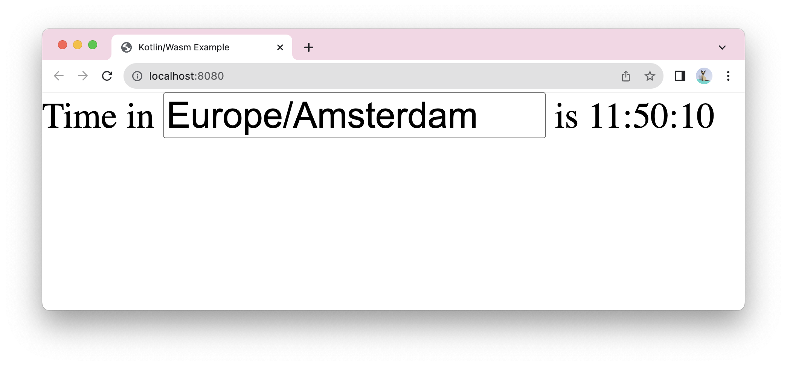

# Kotlin/Wasm Browser Example

A simple app drawing an input field for a timezone name and time in the timezone in the HTML document

Check it out:

.

## Set up the environment

Before starting, ensure you have the necessary IDE and browser setup to run the application.

### IDE

We recommend using the latest version of [IntelliJ IDEA](https://www.jetbrains.com/idea/) (2026.2
or later) to work with the project.

To debug Kotlin/Wasm code in IntelliJ IDEA, you must have the JavaScript Debugger plugin installed.
[See more information about the plugin and how to install it.](https://www.jetbrains.com/help/idea/debugging-javascript-in-chrome.html#ws_js_debugging_chrome_before_you_start)

### Browser (for Kotlin/Wasm target)

To run Kotlin/Wasm applications in a browser, you need a browser supporting the [Wasm Garbage Collection (GC) feature](https://github.com/WebAssembly/gc):

**Chrome and Chromium-based**

* **For version 119 or later:**

  Works by default.

**Firefox**

* **For version 120 or later:**

  Works by default.

**Safari/WebKit**

* **For version 18.2 or later:**

  Works by default.

> **Note:**
> For more information about the browser versions, see the [Troubleshooting documentation](https://kotl.in/wasm_help/).

## Build and run

To build and run the application:

1. In IntelliJ IDEA, open the repository.
2. Run the application by typing the following Gradle command in the terminal:

   `./gradlew wasmJsBrowserProductionRun -t`

## Feedback and questions

Give it a try and share your feedback or questions in our [#webassembly](https://slack-chats.kotlinlang.org/c/webassembly) Slack channel.
[Get a Slack invite](https://surveys.jetbrains.com/s3/kotlin-slack-sign-up).
You can also share your comments with [@bashorov](https://twitter.com/bashorov) on X (Twitter).

## Learn more

* [Kotlin/Wasm](https://kotl.in/wasm/)
* [Other Kotlin/Wasm examples](https://github.com/Kotlin/kotlin-wasm-examples/tree/main)
